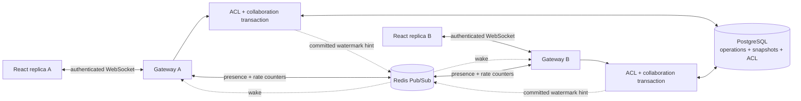

# Distributed Collaborative Editing Engine

## Overview

A Java 21 / Spring Boot backend and React / TypeScript browser editor built around an independently implemented RGA-style sequence CRDT. Multiple users edit the same document through authenticated WebSockets. PostgreSQL stores operations and materialized snapshots; Redis carries ephemeral presence, rate-limit counters and cross-instance commit notifications.

This is a bounded, text-only portfolio system. It demonstrates concurrent editing and recovery with executable tests. It is not an internet deployment, a formally verified CRDT, or a claim of large-scale production capacity.

## Demo

The browser application is called **Common**. Start the stack using [Running Locally](#running-locally), then open [localhost:5173](http://localhost:5173).

1. Register two accounts in separate browser profiles/windows or tabs. Session credentials are scoped to each tab's session storage.
2. Create a document as the first user. Under **People**, grant the second account **Editor** access. The account must already exist; the app does not send email.
3. Open that document as both users. Write `HELLO`, then insert different characters after `H` in both sessions. Both replicas reach the same order.
4. Disconnect one session with the editor's **Disconnect** button. Edit from the other session, then reconnect. The missed operations appear.
5. Change the second user's role to **Viewer** using the same sharing form. Its textarea becomes read-only, and the server rejects edit frames even if a client bypasses the UI.
6. Inspect **History** for persisted operation versions. **Export draft** saves the currently visible text, including any pending edits.

The implementation was exercised with two real browser sessions: concurrent `X`/`Y` inserts produced `HXYELLO 🌍` in both, followed by recovery of edits made during disconnection. See [verification evidence](docs/VERIFICATION.md) for exact scope and tooling limitations.

## Engineering Highlights

- Plain Java CRDT with immutable operation records, logical predecessor IDs, canonical UUID tie-breaking, tombstones and bounded pending dependency queues; no CRDT dependency.
- Independent TypeScript replica, Unicode-scalar diffs, IME composition buffering and logical selection anchors.
- PostgreSQL row locking for atomic append watermarks and permission changes; text ordering comes from the CRDT, never the database sequence.
- Unique operation IDs, checksum-verified persistence, atomic batches and idempotent acknowledgments after commit.
- One-time, short-lived WebSocket tickets, server-issued actors and generation fencing on reconnect.
- Snapshot recovery that reapplies unacknowledged local operations; database polling repairs lost Pub/Sub notifications.
- Reproducible convergence tests, real-service integration contracts, two-instance smoke script and measured benchmarks.

## Architecture



[Architecture](docs/ARCHITECTURE.md) describes transaction and failure boundaries. `dev.collab.crdt` has no Spring dependency; persistence, REST, security and realtime transport live in separate packages.

## Why CRDT?

Database locking can serialize server transactions but cannot express the intent of two users who edited the same older document independently. A numeric character offset becomes stale when another writer inserts text. This CRDT names an immutable predecessor and target element instead. Replicas can merge the same valid operation set in different arrival orders and arrive at the same sequence. PostgreSQL still uses a short document-row lock to assign a replay watermark and commit related records consistently.

## CRDT Model

An operation ID is `(actor UUID, per-actor sequence)`. An inserted element ID is `(actor UUID, Lamport counter)`. Each insert contains one Unicode scalar and a predecessor ID, or null for the root. A delete references an element and marks it as a tombstone. Children of deleted nodes remain reachable.

Sibling nodes sort by descending logical counter, then descending canonical lowercase UUID string. An iterative depth-first traversal renders visible text. References must have lower logical counters than their dependent operation, preventing predecessor cycles even when dependencies arrive late. All counters fit JavaScript's safe integer range. See [the design written before implementation](docs/CRDT_DESIGN.md) and [algorithm costs](docs/ALGORITHMS.md).

## Convergence

Convergence is conditional on replicas eventually receiving the same finite set of valid, uniquely identified operations and remaining within resource bounds. Missing insert/delete dependencies are buffered. Identical duplicate IDs are no-ops; conflicting reuse is rejected. Logical time and UUID ordering are deterministic; wall-clock timestamps never order text.

Tests include same-position inserts, concurrent deletes, delete-before-insert, tombstoned ancestors, shuffled duplicate delivery, three independently edited replicas, snapshot restoration, Unicode and 10,000-element chains. Seeded randomized tests provide implementation evidence, not a general formal proof or Byzantine consensus guarantee.

## Real-Time Protocol

The browser first obtains an authorized connection ticket over REST. It joins the document at its last contiguous server watermark, then exchanges `EDIT`, `ACK`, `SYNC_RESPONSE` and presence messages. Edits are batches of at most 32 operations. ACKs remove retry work; **ACKs do not advance the replay cursor**. Only contiguous history advances that cursor.

A disconnected browser disables new typing and retains unacknowledged operations in memory. Reconnect fences the old actor connection and resends the same IDs. Unacknowledged edits are not durable across closing/reloading the tab; the app warns before unload and offers draft export. [Full protocol](docs/PROTOCOL.md).

## Persistence & Snapshots

Flyway creates users, documents, memberships, actor bindings, hashed one-time tickets, operation log and snapshots. JPA manages users/documents; parameterized JDBC queries handle ordered log access and compound records inside the same transaction manager.

Every 50 accepted operations, the append transaction stores materialized nodes, tombstones, pending dependencies, deduplication signatures and logical time with a checksum and watermark. Loading restores those indexes and applies the later log suffix. The latest three checkpoints are retained. All operations and tombstones remain; safe collection requires causal-stability tracking that is not implemented. A document's operation count is capped to prevent indefinite growth.

## Multi-Instance Design

Run `docker compose --profile multi up -d --build` for a second backend on loopback port 8082. Both instances share PostgreSQL and Redis. A committed edit publishes a source-instance/document/watermark hint; receiving instances fetch the canonical operations from PostgreSQL and broadcast them. Recipients never republish hints. Redis does not carry sensitive document content in its Pub/Sub message.

Each gateway also polls active documents roughly once per second. Lost or duplicate hints therefore affect latency, not durable recovery. Reconnect can use the operation log or HTTP snapshot fallback. Two local backend processes passed the smoke script; horizontal capacity and high availability have not been load-tested.

## Security

Passwords use BCrypt cost 12 with a 72 UTF-8-byte maximum. JWTs have a 15-minute lifetime, issuer/audience checks and a random environment-provided HMAC key. Document permissions are checked in REST, ticket issuance, handshake, join, replay and every edit. Actor IDs are bound to user/document on the server. VIEWER/EDITOR/OWNER roles are enforced independently of the UI.

WebSocket tickets are single-use, expire after 30 seconds and are stored only as SHA-256 digests. The ticket travels in an offered subprotocol; only `collab.v1` is selected in the response. No credential is put in a query string. Exact origin allowlists, byte/message limits, Redis-backed rate limits and bounded CRDT resources limit abuse. React renders plain text; production Nginx sends a restrictive CSP. Document contents, passwords, tickets and JWTs are excluded from application logs.

The Compose stack publishes only loopback application ports. PostgreSQL and Redis have no host port mappings. Public deployment requires HTTPS/WSS, operational secret management, restricted infrastructure access and reviewed backup/retention policies. This is not end-to-end encryption: authorized backend/database operators can read document data. [Security policy](SECURITY.md) · [Threat model](docs/THREAT_MODEL.md).

## Testing

```sh
mvn clean verify
cd frontend
npm ci
npm run typecheck
npm test
npm run build
npm audit --audit-level=low
```

Java unit tests always run. The Testcontainers contract runs against real PostgreSQL and Redis when Docker is available; local runs without Docker explicitly skip it. CI requires Docker and checks that container tests actually ran. An opt-in native-services contract provides equivalent test coverage when Docker is unavailable; see [verification](docs/VERIFICATION.md). No H2 or in-memory replacement is presented as a PostgreSQL integration test.

After starting a stack, run the smoke test (requires `frontend/npm ci`):

```sh
node scripts/smoke.mjs
# Two instances, POSIX shell:
SMOKE_BASE_B=http://localhost:8082 node scripts/smoke.mjs
```

Security scan:

```sh
mvn dependency:tree -DoutputType=json -DoutputFile=target/dependency-tree.json
node scripts/audit-runtime.mjs
gitleaks git --redact --no-banner
```

Scans are point-in-time checks against known advisories/patterns; they are not proof of security. CI also builds and starts Compose, checks readiness and runs the smoke test without private credentials.

## Running Locally

Prerequisites: Docker Engine with Compose for the full stack; Node 24+ for secret generation and local frontend work; Java 21 and Maven 3.9+ for native backend development/tests.

```sh
node scripts/init-env.mjs
docker compose config --quiet
docker compose up -d --build
```

The secret generator creates an ignored `.env` with fresh random values and refuses to overwrite existing secrets. Never commit that file. Open [Common](http://localhost:5173), with the backend health endpoint at [localhost:8080/actuator/health](http://localhost:8080/actuator/health).

For native development, provide `DATABASE_URL`, `DATABASE_USER`, `DATABASE_PASSWORD`, `REDIS_HOST`, `REDIS_PORT`, `REDIS_PASSWORD`, `JWT_SECRET` and `ALLOWED_ORIGINS` in the process environment, then run `mvn spring-boot:run`. In `frontend`, run `npm ci && npm run dev`. The Vite proxy forwards `/api` and `/ws` to port 8080. The Compose `.env` file is consumed by Compose; Spring does not automatically load it during a native run.

Stop with `docker compose down`; it retains the named PostgreSQL volume. Avoid deleting volumes unless their contents are disposable. This repository does not include production secrets or demo accounts.

## API

All REST routes use `/api/v1`; all except register/login require `Authorization: Bearer <JWT>`. DTOs validate inputs and errors return a bounded `code`; application-handled errors also include a correlation `requestId`.

| Method | Route | Purpose |
|---|---|---|
| POST | `/auth/register`, `/auth/login` | Account/session |
| POST, GET | `/documents` | Create/list accessible documents (`offset`, `limit`) |
| GET, DELETE | `/documents/{id}` | Read metadata / owner deletion |
| POST, GET | `/documents/{id}/members` | Owner grants role / list members |
| DELETE | `/documents/{id}/members/{userId}` | Owner revokes membership |
| GET | `/documents/{id}/history?after=0&limit=100` | Ordered operation history |
| GET | `/documents/{id}/snapshot` | Current materialized CRDT state and watermark |
| POST | `/documents/{id}/connections` | Issue one-time WebSocket ticket; optional existing `actorId` |

OpenAPI generation is disabled by default. Set `OPENAPI_ENABLED=true` to expose authenticated `/v3/api-docs` and Swagger resources. The exact realtime schemas and example payloads are in [PROTOCOL.md](docs/PROTOCOL.md).

## WebSocket Protocol

Endpoint: `/ws/documents/{documentId}`. Offered protocols: `collab.v1, ticket.<one-time-ticket>`. Every client message carries `protocolVersion: 1`, `documentId`, `actorId`, `type` and the type-specific fields. Unknown fields, duplicate JSON keys, malformed IDs, conflicting operations and unsupported message types are rejected.

| Client → server | Server → client |
|---|---|
| `JOIN_DOCUMENT`, `SYNC_REQUEST` | `SYNC_RESPONSE` or `SYNC_REQUIRED` |
| `EDIT` (insert/delete batch) | durable `ACK`, then ordered history |
| `PRESENCE` (logical selection anchors) | ephemeral `PRESENCE` list |
| `LEAVE_DOCUMENT` | connection close |
| Invalid/unauthorized input | bounded `ERROR`, usually connection close |

## Observability

Actuator health/readiness exposes no sensitive details. Prometheus requires an operator-issued JWT with `metrics.read` scope; normal account tokens never receive that scope. Operators must provision that credential through a trusted process using the deployment's signing authority.

Metrics include `collab.connections.active`, `collab.operations{outcome}`, `collab.operations.pending`, `collab.snapshots.created`, `collab.websocket.messages{direction}`, `collab.websocket.errors{code}` and notification failures. Labels are bounded; no document IDs, user IDs or content appear in metric labels. A scheduler samples the pending-operation gauge every 30 seconds. Request IDs and random connection IDs support safe diagnostics. Counters are process-local and reset on restart.

## Failure Handling

| Failure | Behavior |
|---|---|
| ACK lost after commit | Resend same immutable operation ID; duplicate ACK, no extra version |
| Missing dependency | Buffer within the per-document cap; integrate when dependency arrives |
| Redis notification lost | Periodic PostgreSQL catch-up repairs connected replicas |
| Redis unavailable | Protected HTTP requests/new edits fail closed; persisted replay may continue; presence reports unavailable |
| Database unavailable | No successful edit ACK; connection error/reconnect retains pending edits in memory |
| Large replay gap | HTTP materialized snapshot plus reapplication of unacknowledged edits |
| Role revoked / document deleted | Subsequent checks reject access and close affected connections |
| JWT expires | Connection closes; export pending draft and sign in again |
| Capacity exhausted | Reject transaction; surface unsaved draft instead of dropping edits silently |

## Performance

Measured on the development Windows host using Java 21, four active JVM processors and a 512 MiB heap. The core harness warms up five times and reports the median of 15 runs; operations are prepared before timing.

| Elements | Apply median | Render median | Snapshot restore median |
|---:|---:|---:|---:|
| 1,000 | 2.523 ms | 0.780 ms | 4.725 ms |
| 10,000 | 6.299 ms | 1.206 ms | 8.538 ms |

The two-instance smoke test measured 128 operations, batches of 16, one submitting client, including PostgreSQL persistence and snapshot creation: **780.63 ms / 163.97 operations per second**. This is one small loopback sample, not a throughput limit, p95 latency, concurrent load test, or horizontal-scaling claim. Two other backend processes and a browser were active during parts of local verification. [Methodology and evidence](docs/VERIFICATION.md).

## Limitations

- Per document: 5,000 inserted nodes including tombstones, 10,000 operations, 256 pending dependencies, 100 members and 1,000 server-issued actors. Per owner: 100 active documents. Per process: 128 sockets and 64 per document.
- The server reconstructs materialized state inside each append transaction. This O(state + replay suffix) work and the document-row lock limit throughput; this is not a high-throughput editor backend.
- The TypeScript sibling index uses binary search plus array insertion, with O(s) movement for s siblings. Local atomic batch validation clones bounded state. Java uses ordered tree sets.
- Unicode scalars are supported; grapheme clusters, rich text, undo/redo, non-interleaving insertion intentions and durable offline editing are not implemented.
- Session storage remains exposed to same-origin XSS. No password reset, email verification, refresh tokens, user account deletion or ownership transfer.
- No safe tombstone GC, distributed presence ordering, automated backup restore drill, production TLS deployment, penetration test or public-scale load test is claimed. Container execution was unavailable in the development environment; CI defines that verification separately.

## Future Work

Introduce a versioned per-document cache with transactional invalidation and recovery tests; move to an indexed sequence for larger documents; add causal-stability-based compaction; implement durable client outboxes and safe actor recovery; test fault injection over several nodes; add operational backup/restore drills and deployment-managed identity. Each change should preserve the existing convergence and recovery contract before raising document or connection limits.
